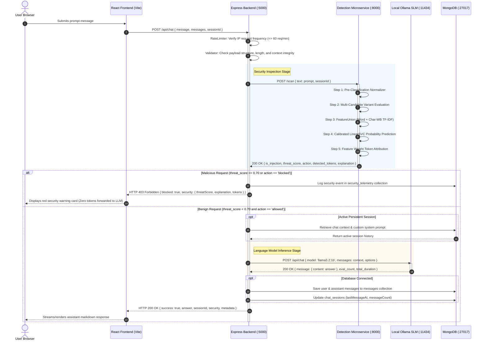
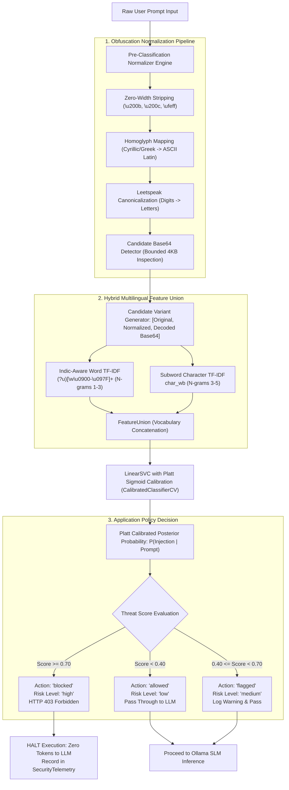
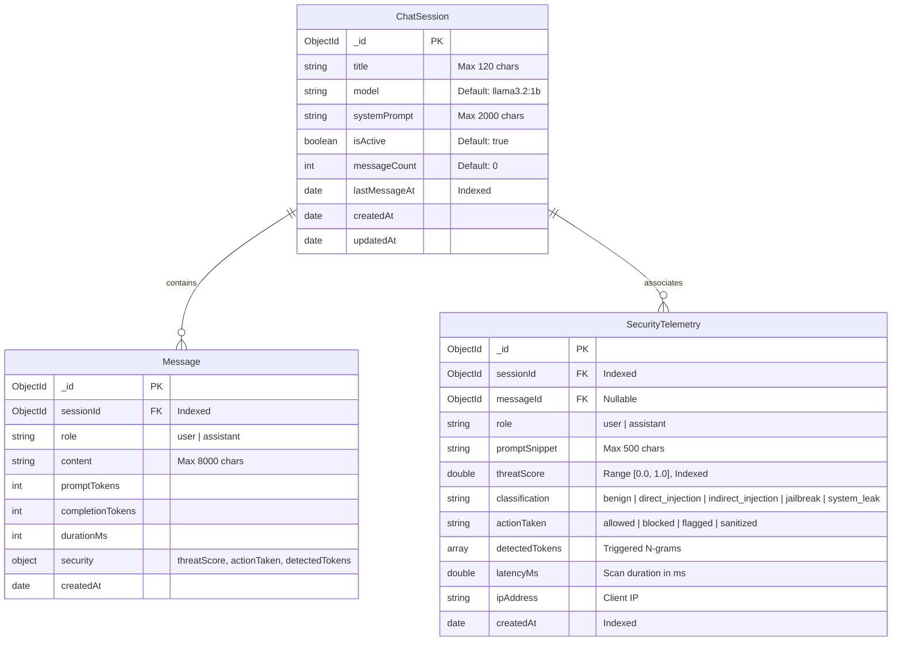

# SecureChat AI — System Architecture & Technical Design

This document details the multi-tier software architecture, component topologies, request lifecycles, prompt injection detection pipelines, and database design of **SecureChat AI v1.0.0**.

---

## 1. High-Level System Architecture

SecureChat AI separates client presentation, API validation, security guardrail inspection, persistent conversation storage, and local Small Language Model (SLM) inference into decoupled subsystems:

```mermaid
graph TD
    User([End User / Web Browser])

    subgraph ClientTier ["Frontend Tier (Port 5173 / Port 80)"]
        ReactApp["React 19 SPA (Vite)"]
        LocalStorage[("Browser LocalStorage (Offline Fallback)")]
        Nginx["Nginx Reverse Proxy (/api/* -> backend:5000)"]
    end

    subgraph ApplicationTier ["Application Backend Tier (Port 5000)"]
        ExpressRouter["Express.js Router"]
        InputValidator["Input & Context Validator"]
        RateLimiter["Sliding-Window Rate Limiter (60 req/min)"]
        SecurityMiddleware["Security Guardrail Middleware"]
        FallbackGuard["Heuristic Regex Scanner (Zero-Downtime Fallback)"]
        ChatController["Chat & Session Controllers"]
    end

    subgraph DetectionTier ["Security ML Detection Tier (Port 8000)"]
        FastAPIApp["FastAPI REST Microservice"]
        Normalizer["Pre-Classification Normalizer"]
        subgraph NormalizationModules ["Normalization Components"]
            ZWStrip["Zero-Width Stripper (\u200b, \u200c, \ufeff)"]
            Homoglyph["Homoglyph Canonicalizer (Cyrillic/Greek -> Latin)"]
            LeetDecoder["Leetspeak Decoder (Bounded Digit Mapping)"]
            B64Candidate["Safe Base64 Inspector (4KB Bounded Decoding)"]
        end
        HybridPipeline["Scikit-Learn FeatureUnion Pipeline"]
        subgraph PipelineModules ["ML Feature Extraction & Classification"]
            WordTFIDF["Word TF-IDF (N-grams 1-3, (?u)[\w\u0900-\u097F]+)"]
            CharTFIDF["Subword Char-WB TF-IDF (N-grams 3-5)"]
            LinearSVC["Platt-Calibrated LinearSVC Classifier"]
        end
        TokenAttribution["Explainable Feature Weight Attributor"]
    end

    subgraph DataTier ["Persistence Tier (Port 27017)"]
        MongoDB[(MongoDB 7.0 Database)]
        ColSessions[("chat_sessions")]
        ColMessages[("messages")]
        ColTelemetry[("security_telemetry")]
    end

    subgraph InferenceTier ["Local SLM Inference Tier (Port 11434)"]
        HostOllama["Host Ollama Server"]
        SLMModel["llama3.2:1b (1.3 GB Local Model)"]
    end

    User <-->|HTTP / WebSocket| ReactApp
    ReactApp -->|Static Assets| Nginx
    Nginx -->|Reverse Proxy /api/| ExpressRouter
    ExpressRouter --> RateLimiter
    RateLimiter --> InputValidator
    InputValidator --> SecurityMiddleware
    SecurityMiddleware -->|POST /scan (1500ms timeout)| FastAPIApp
    SecurityMiddleware -.->|Fallback on Timeout| FallbackGuard

    FastAPIApp --> Normalizer
    Normalizer --> NormalizationModules
    NormalizationModules --> HybridPipeline
    HybridPipeline --> PipelineModules
    PipelineModules --> TokenAttribution
    TokenAttribution --> FastAPIApp

    SecurityMiddleware -->|Enforce Policy (Score >= 0.70)| ChatController
    ChatController <-->|Mongoose ODM| MongoDB
    MongoDB --- ColSessions
    MongoDB --- ColMessages
    MongoDB --- ColTelemetry

    ChatController <-->|POST /api/chat (Host Gateway)| HostOllama
    HostOllama --- SLMModel
```

---

## 2. Request Lifecycle & End-to-End Data Flow

The sequence diagram below traces the end-to-end journey of user requests through input validation, ML security scanning, policy enforcement, local SLM inference, and MongoDB telemetry persistence.



---

## 3. Prompt Injection Detection Workflow

The detection engine implements a multi-stage defense-in-depth pipeline designed to counter both direct injection instructions and complex evasion techniques:



---

## 4. Database Architecture & Schema Design

When MongoDB is active, SecureChat AI maintains conversational history, session state, and security telemetry. When MongoDB is unavailable, the application gracefully degrades to stateless mode with client-side `localStorage` caching.



### Important Indexes:
1. `ChatSession`: `{ lastMessageAt: -1 }` for rapid retrieval of recent conversations.
2. `Message`: `{ sessionId: 1, createdAt: 1 }` for ordered retrieval of conversation history.
3. `SecurityTelemetry`: `{ threatScore: -1, createdAt: -1 }` for security audit queries and threat aggregation.
