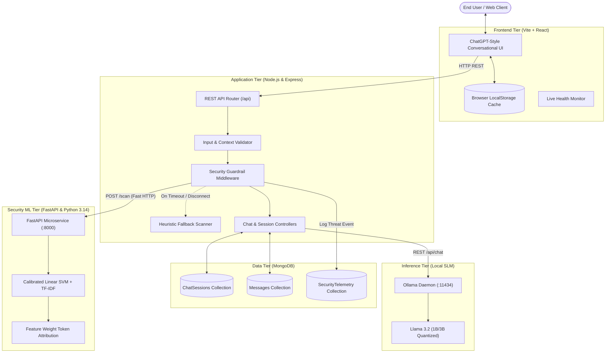
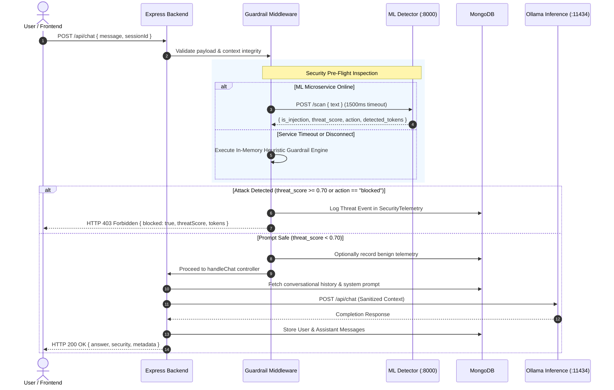

# SecureChat AI — System Architecture & Security Design

This document details the multi-tier architecture, security defense-in-depth pipeline, and fault-tolerant communication flows of **SecureChat AI**.

---

## 1. Architectural Overview

SecureChat AI separates conversational interface management, prompt security inspection, session persistence, and local language model inference into dedicated decoupled layers:

---

## 2. Core Subsystems

### 2.1 Frontend Tier (`/frontend`)
- **Technology:** React 19, Vite, Lucide Icons, Vanilla CSS design system.
- **Key Responsibilities:**
  - Modern ChatGPT-style chat interface with responsive layout and mobile drawer.
  - Multi-turn conversation management with automatic title generation.
  - Transparent security indicators displaying risk badges (Low, Medium, High, Critical), detected adversarial tokens, and confidence scores.
  - Dual-tier persistence: Synchronizes with backend MongoDB when connected; falls back to browser `localStorage` when offline.

### 2.2 Backend Application Tier (`/backend`)
- **Technology:** Node.js, Express.js (ES Modules).
- **Key Responsibilities:**
  - Strict schema and conversational context validation (`validator.js`).
  - Pre-execution security enforcement via middleware (`securityGuardrail.js`).
  - Resilient inference broker communicating with Ollama with configurable timeouts (`ollamaService.js`).
  - Session lifecycle management, multi-turn history stitching, and telemetry auditing (`sessionController.js`, `telemetryController.js`).

### 2.3 Machine Learning Security Microservice (`/detection-service`)
- **Technology:** FastAPI, Scikit-learn, Joblib, Python 3.14.
- **Key Responsibilities:**
  - Sub-5ms prompt classification using a calibrated Linear Support Vector Machine (`LinearSVC`) with sublinear term-frequency (`TF-IDF`).
  - Platt scaling calibration (`CalibratedClassifierCV`) yielding smooth confidence probabilities ($[0.0, 1.0]$).
  - Explainable token attribution: extracts top adversarial hyperplane weights to pinpoint exact malicious trigger words.

### 2.4 Persistence Tier (MongoDB)
- **Schemas:**
  - `ChatSession`: Conversational sessions, model configurations, custom system prompts, and message counters.
  - `Message`: Immutable turn-by-turn logs with token consumption metrics and latency timestamps.
  - `SecurityTelemetry`: Comprehensive security incident logs recording prompt snippets, threat scores, classifications, actions, and detected tokens.

### 2.5 Inference Tier (Ollama)
- **Model:** `llama3.2:1b` (or `llama3.2:3b`), hosted locally via Ollama.
- Isolated from direct public exposure; accessible strictly through backend proxy controllers.

---

## 3. Security Inspection Sequence Flow

The following sequence illustrates how incoming prompts are inspected before reaching the language model:

---

## 4. Resilience & Degradation Modes

| Subsystem State | Impact on Operations | Degradation Strategy |
| :--- | :--- | :--- |
| **Detection Service Offline** | ML classification unavailable | Transparently falls back to in-memory regex heuristic scanner (`fallbackGuardrail.js`). Zero downtime. |
| **MongoDB Disconnected** | Chat history persistence unavailable | Backend operates in stateless mode. Frontend falls back to browser `localStorage` for conversation continuity. |
| **Ollama Timeout (>120s)** | SLM inference stalled | Graceful HTTP 504 Gateway Timeout returned with user-friendly retry message; prevents hung connections. |
| **Ollama Offline** | Model generation unavailable | HTTP 503 Service Unavailable returned with actionable setup instructions. Health check reports degraded state. |
